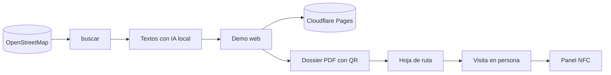

# webs-comercios


**Un agente de prospección comercial para vender webs a comercios de barrio.** Busca en OpenStreetMap los comercios de Murcia que no tienen web, les prepara una demo adaptada (con textos generados por IA), un dossier PDF con un QR a su demo y una hoja de ruta para visitarlos.

> Nada se envía solo: el primer contacto siempre es en persona o por teléfono, porque la LSSI prohíbe el correo y el WhatsApp comercial no pedido.

## Qué hace



| Paso | Resultado |
|---|---|
| 🔎 **Buscar** | ~1.000 comercios de Murcia sin web y que no son de cadenas, con sector, dirección y horario |
| ✍️ **Redactar** | Textos de la demo con un modelo local, sin inventar precios ni nombres, con textos de respaldo por sector |
| 🌐 **Demo** | Web por sector (colores, icono, llamadas a la acción), marcada como DEMO y sin indexar, en `demo.redgarverde.com/<slug>/` |
| 📄 **Dossier** | PDF A4 de 2 páginas con capturas en móvil y ordenador, QR a la demo y la oferta de web + placa NFC |
| 🗺️ **Ruta** | Visitas ordenadas por cercanía, con guion y QR de Google Maps |
| 🤝 **Seguimiento** | Estado de cada comercio, paso de los interesados al [panel NFC](https://github.com/jlgarciavalverde/nfc-bot) y borrado a petición (RGPD) |

## Empezar

```sh
cp config.toml.example config.toml   # precios, nombre y teléfono del dossier
uv sync
npx wrangler login                   # una vez, para publicar en Cloudflare Pages
uv run pytest                        # tests
```

## Uso

```sh
uv run webs buscar                    # descarga comercios sin web (OSM)
uv run webs lote --tipo peluqueria --n 10 [--desde 37.99,-1.13] [--radio 2]
#   → elige, redacta, genera las demos, publica y hace los dossiers y la ruta en salida/rutas/<fecha>/
uv run webs lista --estado dossier
uv run webs anotar 537 interesado "volver el martes por la tarde"
uv run webs importar-nfc              # visitados, interesados y clientes → panel NFC (por SSH al VPS)
uv run webs limpiar --dry-run         # demos caducadas (30 días) de quien no está interesado
uv run webs borrar 537                # derecho de supresión
```

- **Sectores** para `--tipo`: restaurante, belleza, salud, taller y tienda, o sus alias (peluqueria, estetica, bar, cafeteria, dentista, clinica, fisio, veterinario, gimnasio, mecanico, bicis).
- **Estados**: `nuevo → demo → publicado → dossier → visitado → interesado | no | cliente` (y `descartado`).

## Estructura

| Archivo | Qué hace |
|---|---|
| `webs/cli.py` | Comandos |
| `webs/osm.py` | Overpass (con reintentos y espejos), filtro de comercios sin web y sin cadenas, sector y Nominatim |
| `webs/llm.py` | Textos con OmniRoute local: JSON validado y respaldo fijo por sector |
| `webs/demos.py` + `plantillas/demo.html` | Demo por sector con franja «DEMO», `noindex`, `robots.txt` y `_headers` |
| `webs/publicar.py` | Subida a Cloudflare Pages con wrangler |
| `webs/dossier.py` + `plantillas/dossier.html` | Capturas con Chrome headless, QR y PDF |
| `webs/ruta.py` + `plantillas/ruta.html` | Orden por cercanía y hoja de ruta |
| `webs/nfc.py` | Alta en el panel NFC por SQL, sin duplicar y como operación que se puede deshacer |
| `webs/db.py` | Estado local en SQLite (`datos/leads.sqlite`) |

`datos/`, `salida/` y `config.toml` no se versionan.

## Documentación

| Para… | Lee |
|---|---|
| Entender qué hace | [Requisitos](docs/requisitos.md) · [Flujos](docs/flujos.md) |
| Entender cómo está hecho | [Arquitectura](docs/arquitectura.md) (módulos, ciclo de vida, modelo de datos y decisiones) |

## Licencia

Todos los derechos reservados: el código se puede consultar, pero no usar, copiar ni desplegar sin permiso. Ver [LICENSE](LICENSE).
