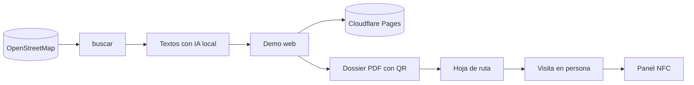

# webs-comercios


Agente que busca comercios de Murcia **sin web** en OpenStreetMap, les prepara una **demo web adaptada** (textos con IA),
un **dossier PDF** con QR a su demo y el pack web + placa NFC, y una **hoja de ruta** para visitarlos.

Nada se envía solo: el primer contacto es en persona o por teléfono (la LSSI prohíbe el email/WhatsApp comercial no pedido).



Diseño y detalle: [arquitectura](docs/arquitectura.md) · [requisitos](docs/requisitos.md) · [flujos](docs/flujos.md).

## Uso

```sh
cp config.toml.example config.toml   # precios, nombre y teléfono del dossier
uv sync
npx wrangler login                    # una vez, para publicar en Cloudflare Pages

uv run webs buscar                    # descarga comercios sin web (OSM), ~1000 en Murcia
uv run webs lote --tipo peluqueria --n 10 [--desde 37.99,-1.13] [--radio 2]
#   → elige, redacta (IA), genera demos, publica, hace dossiers y la ruta en salida/rutas/<fecha>/
uv run webs lista --estado dossier
uv run webs anotar 537 interesado "volver el martes por la tarde"
uv run webs importar-nfc              # visitados/interesados/clientes → panel NFC (por SSH al VPS)
uv run webs limpiar --dry-run         # demos caducadas (30 días) de quien no está interesado
uv run webs borrar 537                # derecho de supresión
```

Sectores para `--tipo`: restaurante, belleza, salud, taller, tienda (o alias: peluqueria, estetica, bar, cafeteria,
dentista, clinica, fisio, veterinario, gimnasio, mecanico, bicis).

Estados: `nuevo → demo → publicado → dossier → visitado → interesado | no | cliente` (y `descartado`).

## Piezas

| Archivo | Qué hace |
|---|---|
| `webs/osm.py` | Overpass (con reintentos y espejos), filtro sin web/sin cadenas, sector, Nominatim para barrio/dirección |
| `webs/llm.py` | Textos con OmniRoute local (`free-fast`, clave `OMNIROUTE_API_KEY` de `~/.hermes/.env`); JSON validado, sin precios ni nombres inventados; respaldo fijo por sector |
| `webs/demos.py` + `plantillas/demo.html` | Demo por sector (colores, icono, llamadas a la acción); franja «DEMO», noindex, `robots.txt`, `_headers` |
| `webs/dossier.py` + `plantillas/dossier.html` | Capturas móvil/ordenador con Chrome headless, QR, PDF A4 de 2 páginas |
| `webs/ruta.py` + `plantillas/ruta.html` | Orden por cercanía, hoja de ruta con guion y QR de Google Maps |
| `webs/nfc.py` | Alta en el panel NFC por SQL (`docker exec nfc-db psql` en el VPS), sin duplicar y con operación «webs» deshacible |

Las demos se publican en `https://demo.redgarverde.com/<slug>/` (Cloudflare Pages, proyecto `demos-comercios`).
`datos/`, `salida/` y `config.toml` no se versionan.

## Tests

```sh
uv run pytest
```

## Licencia

Todos los derechos reservados: el código se puede consultar, pero no usar, copiar ni desplegar sin permiso. Ver [LICENSE](LICENSE).
