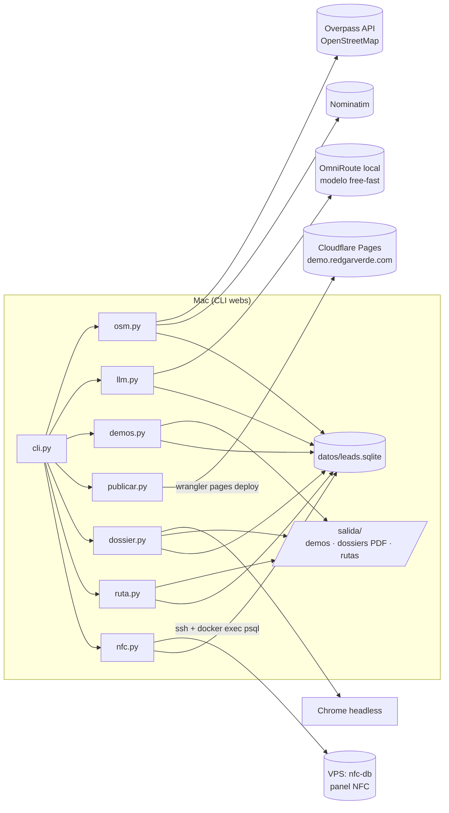
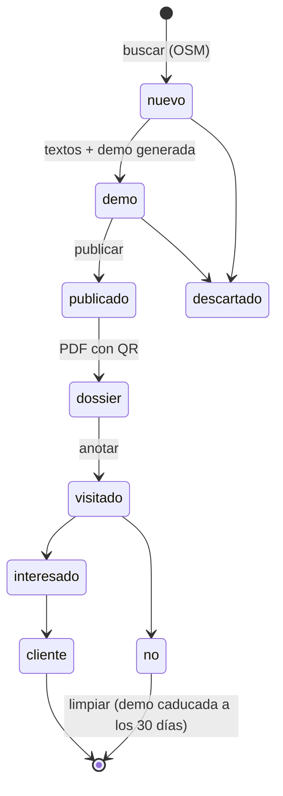
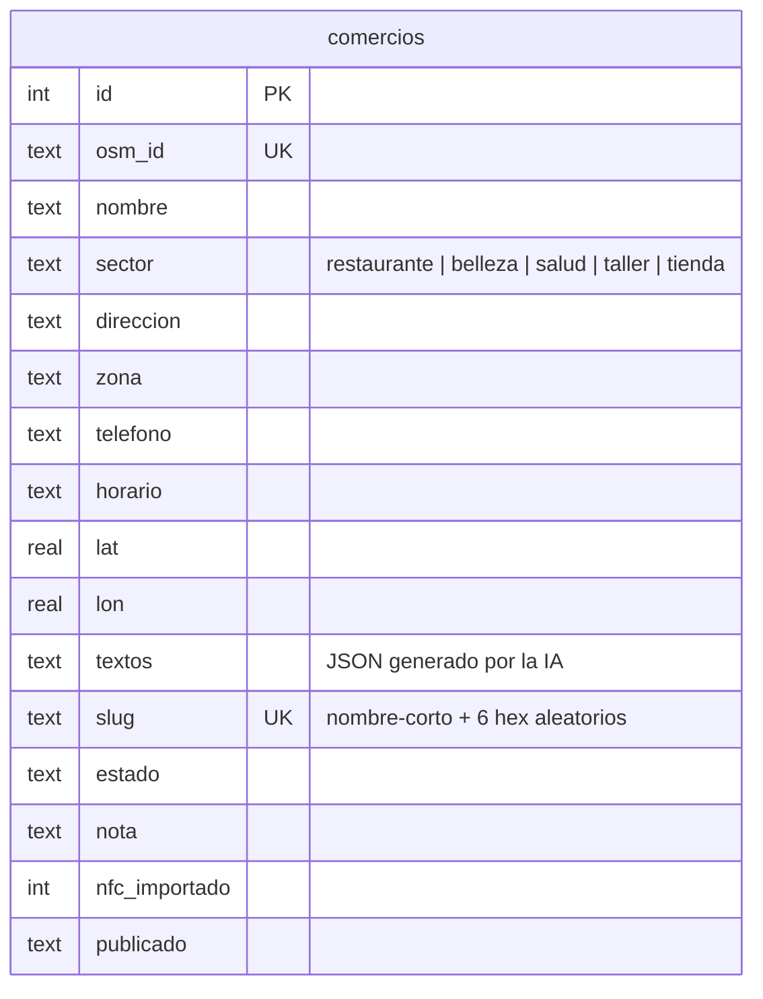

# Arquitectura

`webs-comercios` es una CLI en Python 3.12 (gestionada con `uv`) que va desde la búsqueda de comercios hasta la hoja de ruta para visitarlos. Guarda el estado en un SQLite local y publica las demos como sitio estático.

## Visión general

| Módulo | Qué hace |
|---|---|
| `osm.py` | Consulta Overpass (con reintentos y espejos), descarta comercios con web o de cadenas, asigna el sector y completa barrio y dirección con Nominatim. |
| `llm.py` | Redacta los textos de la demo con un modelo local (OmniRoute). Valida el JSON, prohíbe inventar precios o nombres y tiene textos de respaldo por sector. |
| `demos.py` | Genera la demo de cada comercio desde `plantillas/demo.html`, con colores, icono y llamadas a la acción del sector. Incluye la franja «DEMO», `noindex`, `robots.txt` y `_headers`. |
| `publicar.py` | Sube las demos activas a Cloudflare Pages. |
| `dossier.py` | Hace capturas en móvil y ordenador con Chrome headless y monta un PDF A4 de 2 páginas con QR a la demo y la oferta. |
| `ruta.py` | Ordena las visitas por cercanía (vecino más próximo) y genera la hoja de ruta con guion y QR de Google Maps. |
| `nfc.py` | Da de alta a los visitados en el [panel NFC](https://github.com/jlgarciavalverde/nfc-bot) sin duplicar y como operación que se puede deshacer. |
| `horario.py` | Convierte `opening_hours` de OSM en texto legible para la demo y la hoja de ruta. |

## Ciclo de vida de un comercio

## Modelo de datos

## Decisiones

| Decisión | Por qué |
|---|---|
| Nada se envía solo | La LSSI prohíbe el correo y el WhatsApp comercial no pedido: el primer contacto siempre es en persona o por teléfono. |
| Slug con parte aleatoria | La URL de una demo no se puede adivinar a partir del nombre del comercio. |
| Demos con `noindex` y caducidad | No compiten en Google con el comercio y desaparecen si no hay interés. |
| `borrar <id>` | Derecho de supresión del RGPD: borra el registro y la demo publicada. |
| IA local con respaldo | Sin coste por comercio y sin enviar datos a terceros. Si el modelo falla, la demo sale igual con textos fijos. |
| SQLite local | Herramienta de una sola persona: sin servidor que mantener. |
